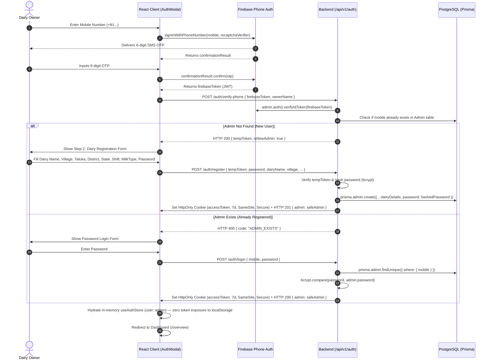
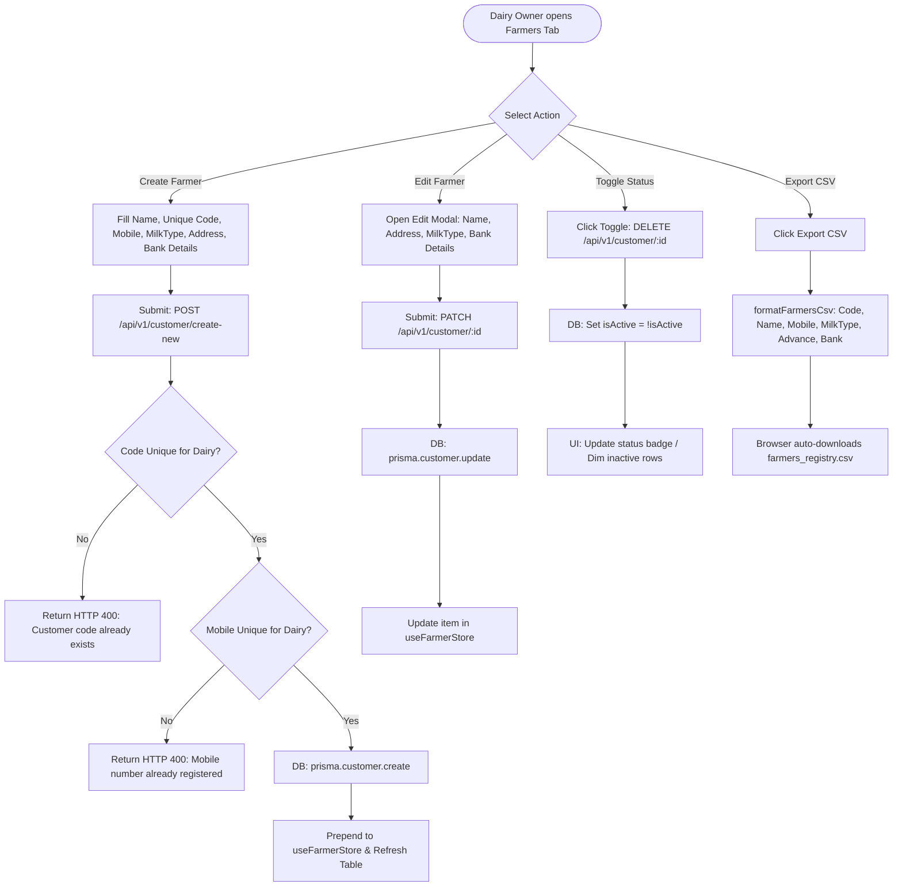
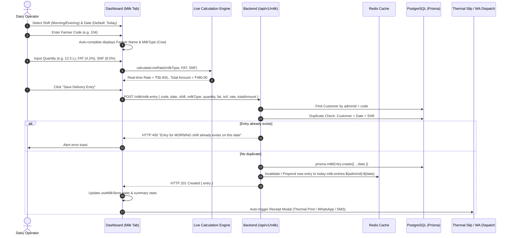
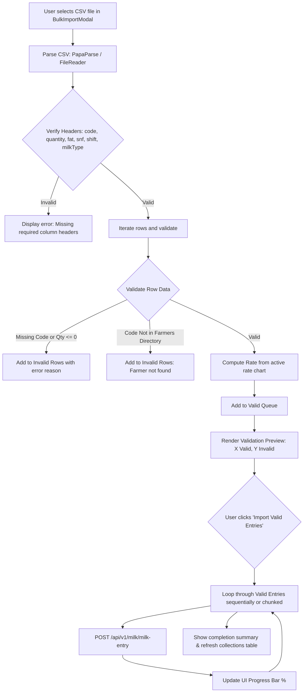
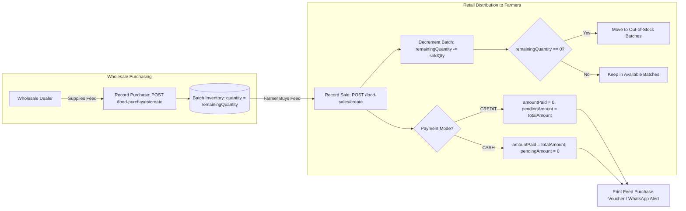
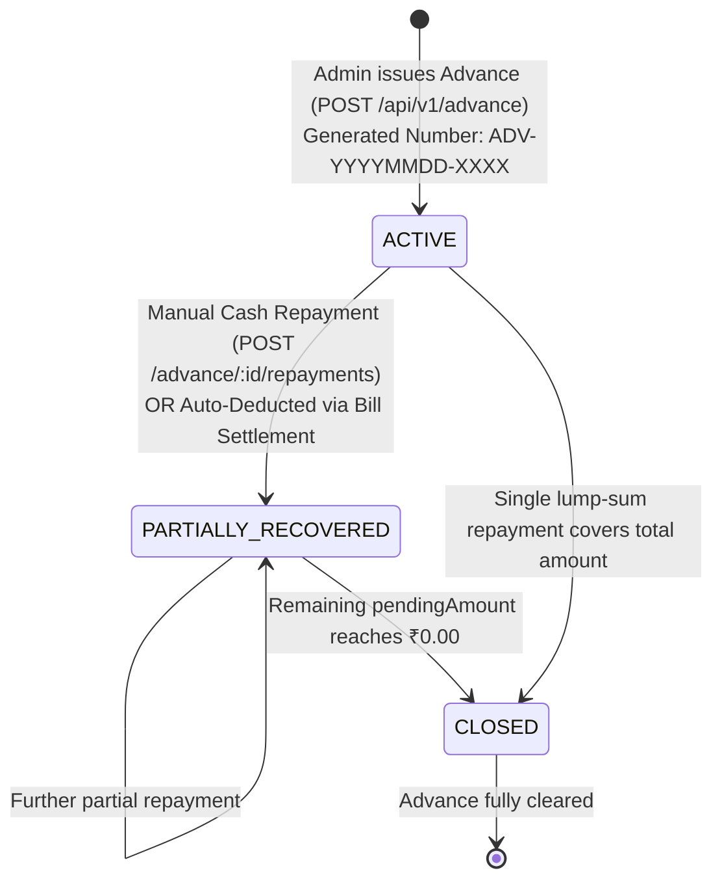
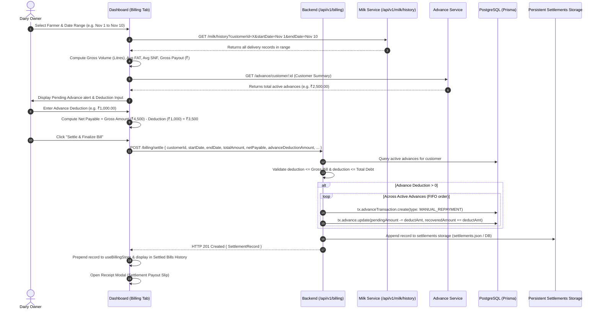
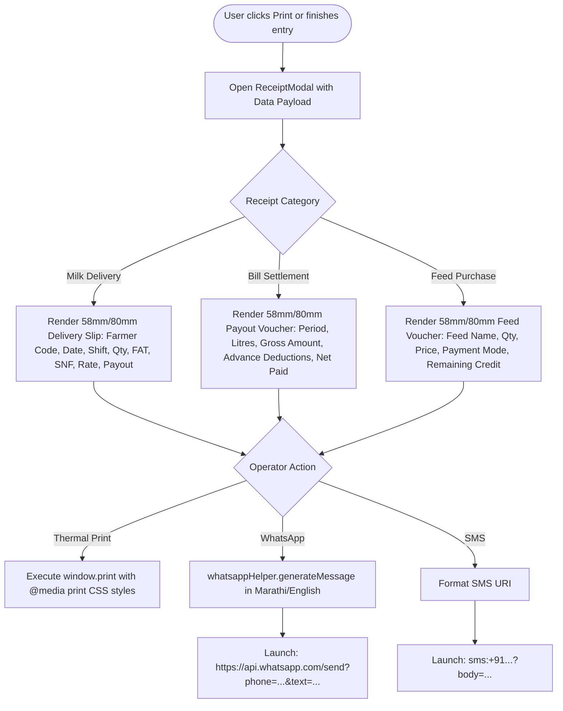
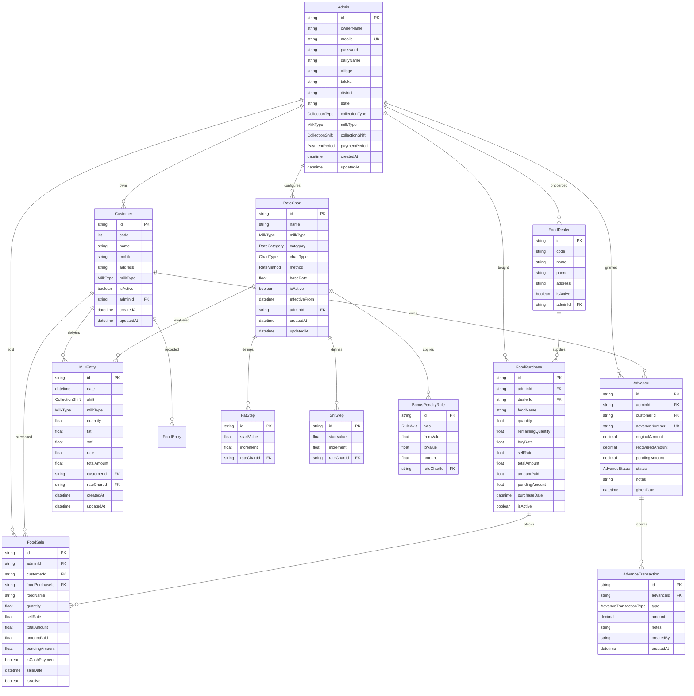

# LactoFlow (Dairy Management System) — Comprehensive Project Analysis & System Architecture Flows

> **Document Version:** 1.0.0  
> **Target System:** LactoFlow Dairy ERP (Multi-Tenant Dairy Procurement, Processing & Financial Operations Platform)  
> **Document Scope:** Full End-to-End System Analysis, Architecture Blueprints, Data Models, Business Logic Flows, Rate Calculation Algorithms, and Complete API Catalog.  
> **Generated Date:** November 2026  
> **File Location:** `docs/COMPLETE_PROJECT_ANALYSIS_AND_SYSTEM_FLOWS.md`

---

## Table of Contents

1. [Executive Summary & Product Vision](#1-executive-summary--product-vision)
2. [High-Level Architecture & Technology Stack](#2-high-level-architecture--technology-stack)
3. [Complete System Flow Diagrams & Logic Walkthroughs](#3-complete-system-flow-diagrams--logic-walkthroughs)
   - [Flow 1: Authentication & Onboarding Lifecycle](#flow-1-authentication--onboarding-lifecycle)
   - [Flow 2: Farmer (Supplier) Lifecycle & Directory Management](#flow-2-farmer-supplier-lifecycle--directory-management)
   - [Flow 3: Rate Chart Engine (Point & Excel Matrix, Multi-Axis Rules)](#flow-3-rate-chart-engine-point--excel-matrix-multi-axis-rules)
   - [Flow 4: Daily Milk Collection & Real-Time Pricing](#flow-4-daily-milk-collection--real-time-pricing)
   - [Flow 5: Bulk Milk Collection Import & CSV Processing](#flow-5-bulk-milk-collection-import--csv-processing)
   - [Flow 6: Cattle Feed Wholesale Inventory & Farmer Sales](#flow-6-cattle-feed-wholesale-inventory--farmer-sales)
   - [Flow 7: Farmer Advance Loans & Repayment Ledger](#flow-7-farmer-advance-loans--repayment-ledger)
   - [Flow 8: Period Billing & Settlement Engine (with Auto-Advance Deduction)](#flow-8-period-billing--settlement-engine-with-auto-advance-deduction)
   - [Flow 9: Dairy Profile & Business Configuration Management](#flow-9-dairy-profile--business-configuration-management)
   - [Flow 10: Receipts, Thermal Printing & WhatsApp/SMS Dispatch](#flow-10-receipts-thermal-printing--whatsappsms-dispatch)
   - [Flow 11: Multi-Language (i18n) & Localized Operations](#flow-11-multi-language-i18n--localized-operations)
4. [Database Schema & Entity Relationship Diagram (ERD)](#4-database-schema--entity-relationship-diagram-erd)
5. [Complete REST API Catalog & Route Specifications](#5-complete-rest-api-catalog--route-specifications)
6. [Frontend State Architecture & Store Directory](#6-frontend-state-architecture--store-directory)
7. [Security, Middleware & Validation Protocols](#7-security-middleware--validation-protocols)
8. [Performance Optimizations & Redis Caching Topology](#8-performance-optimizations--redis-caching-topology)
9. [Identified Technical Gaps, Edge Cases & Roadmap Recommendations](#9-identified-technical-gaps-edge-cases--roadmap-recommendations)

---

## 1. Executive Summary & Product Vision

**LactoFlow** is a cloud-based, multi-tenant Dairy Management Operating System engineered specifically for rural and semi-urban milk collection centers, chilling units, and village dairy cooperatives.

### Core Problems Solved
1. **Manual Ledger Errors:** Replaces paper register tracking of milk quantities, FAT/SNF measurements, and farmer payouts with high-speed, validated entry recording.
2. **Complex Rate Calculations:** Automates milk valuation based on configurable multi-axis rate charts (Point Steps, Excel Matrix tables, FAT/SNF combinations, and bonus/penalty slabs).
3. **Credit & Advance Leakage:** Tracks loans and cash advances issued to farmers, enforcing strict ledger deductions automatically during periodic billing settlements.
4. **Cattle Feed Inventory Tracking:** Manages wholesale purchases of cattle feed from dealers and tracks retail sales to farmers (cash and credit), maintaining batch stock balances.
5. **Instant Farmer Transparency:** Generates 58mm/80mm thermal printer slips and formats instant WhatsApp and SMS dispatch notices in local languages (Marathi, Hindi, English).

### Key Personas
- **Dairy Owner / Admin:** Operates the collection center, configures rate charts, monitors milk volume and profits, settles farmer bills, issues advances, and configures business settings.
- **Farmer / Milk Supplier:** Delivers Cow, Buffalo, or Mixed milk twice daily (Morning / Evening shifts), receives instant receipts, and receives periodic net payouts after advance deductions.
- **Feed Wholesale Dealer:** Supplies cattle feed bags/batches to the dairy on credit or cash terms.

---

## 2. High-Level Architecture & Technology Stack

LactoFlow utilizes a **Clean Layered Client-Server Architecture** with strict domain segregation, centralized middleware, and an event/store-driven UI.

```
+---------------------------------------------------------------------------------------------------+
|                                          FRONTEND (CLIENT)                                        |
|  React 19 + TypeScript + Vite + Tailwind/Vanilla CSS + Lucide Icons + TanStack Query + Zustand    |
|                                                                                                   |
|  +--------------------+  +--------------------+  +--------------------+  +---------------------+  |
|  | Auth & Landing UI  |  | 8-Tab Dashboard UI |  | Rate Chart Module  |  | Thermal / WA Engine |  |
|  +--------------------+  +--------------------+  +--------------------+  +---------------------+  |
|                                     |                                                             |
|                         Zustand Modular Stores & API Client                                       |
+---------------------------------------------------------------------------------------------------+
                                      |  HTTPS / REST (JSON)
                                      v
+---------------------------------------------------------------------------------------------------+
|                                          BACKEND (API)                                            |
|                  Node.js + Express 5 + TypeScript + Prisma ORM + Redis Client                     |
|                                                                                                   |
|  +---------------------------------------------------------------------------------------------+  |
|  | Middleware: CORS | Helmet | Compression | Morgan | HPP | apiLimiter | authMiddleware | Zod  |  |
|  +---------------------------------------------------------------------------------------------+  |
|                                              |                                                    |
|  +---------------------------------------------------------------------------------------------+  |
|  | Modules: Auth | Admin | Customer | MilkEntry | RateChart | FoodDealers | Purchases | Sales   |  |
|  |          Advances | Billing & Settlements                                                   |  |
|  +---------------------------------------------------------------------------------------------+  |
|                               |                                      |                            |
|                               v                                      v                            |
|                    Prisma ORM Client                          Redis Cache Engine                  |
+---------------------------------------------------------------------------------------------------+
                                |                                      |
                                v                                      v
                PostgreSQL Database (Supabase / Neon)          Redis Server (In-Memory)
```

### Technology Stack Details

| Layer | Technologies Used | Key Purpose |
|---|---|---|
| **Frontend Framework** | React 19, TypeScript, Vite | Fast SPA compilation, zero-latency interactions |
| **State Management** | Zustand (11 specialized stores) | Lightweight, non-boilerplate reactive state |
| **Data Fetching** | Axios + TanStack React Query | HTTP requests, request/response interceptors, cache |
| **Styling & UI** | TailwindCSS + Vanilla CSS, Lucide React | High-contrast dark theme, thermal print layouts |
| **Backend Runtime** | Node.js (ES Modules), Express 5 | High-throughput asynchronous REST API |
| **Language** | TypeScript (Strict mode) | End-to-end type safety between DB models and API |
| **ORM & Database** | Prisma ORM, PostgreSQL | Relational integrity, migrations, connection pooling |
| **Cache Engine** | Redis (with non-blocking fallbacks) | Caching active rate charts & today's milk entries |
| **Authentication** | Firebase Phone Auth (Admin SDK) + JWT | OTP verification via SMS, 7-day JWT access tokens |
| **Data Validation** | Zod + Express validation middleware | Strict payload, parameter, and query string validation |
| **Security & Ops** | Helmet, CORS, Express-Rate-Limit, HPP | DDoS mitigation, parameter pollution protection |

---

## 3. Complete System Flow Diagrams & Logic Walkthroughs

---

### Flow 1: Authentication & Onboarding Lifecycle

LactoFlow implements a 2-stage verification flow: Firebase Phone Auth handles SMS OTP verification and generates an identity token, which the backend exchanges for a temporary token (`tempToken`) or completes login.



#### Key Security & Session Rules:
- **Zero LocalStorage Token Storage:** The session JWT `accessToken` is stored in an `httpOnly`, `secure`, `sameSite` cookie. Client-side JavaScript (and XSS attack vectors) cannot access or exfiltrate the token.
- **Session Hydration via `/auth/me`:** When the user loads or refreshes the page, `useAuthStore.initialize()` calls `GET /auth/me` with `credentials: 'include'`. The server validates the cookie and returns the authenticated profile.
- **Graceful Logout via `/auth/logout`:** On user logout, `POST /auth/logout` triggers `res.clearCookie('accessToken')`, resetting all client-side business stores.
- **Session Expiration Guard:** If an API request receives an `HTTP 401 Unauthorized`, an interceptor in `api.ts` broadcasts an `auth-error` event, clearing in-memory user state and redirecting to the Landing/Login view.

---

### Flow 2: Farmer (Supplier) Lifecycle & Directory Management

Farmers are the primary suppliers of raw milk. Every farmer is strictly scoped to a specific dairy (`adminId`).



#### Multi-Tenant Constraints:
- `@@unique([adminId, code])`: Farmer code #101 can exist in Dairy A and Dairy B without conflict.
- `@@unique([adminId, mobile])`: A farmer phone number must be unique within a given dairy.

---

### Flow 3: Rate Chart Engine (Point & Excel Matrix, Multi-Axis Rules)

The Rate Chart module is one of the most critical systems in LactoFlow, determining the exact purchase price per litre of milk based on laboratory measurements (FAT and SNF).

#### Evaluation Modes:
1. **POINT Method:** Evaluated parametrically via base price, incremental step thresholds, and bonus/penalty slabs.
2. **EXCEL Method:** Evaluated via a 2-dimensional grid lookup (Rows = FAT values, Columns = SNF values).
3. **FIXED Method:** Flat rate per litre regardless of FAT/SNF.

```mermaid
flowchart TD
    Input([Input: MilkType, FAT %, SNF %, Category]) --> FetchActive[Query Active Rate Chart from Cache or DB]
    FetchActive --> CheckMethod{Calculation Method?}
    
    CheckMethod -->|FIXED| CalcFixed[Rate = baseRate]
    
    CheckMethod -->|POINT| CalcPoint[Start with Base Rate]
    CalcPoint --> StepFat{FAT > FatStep.startValue?}
    StepFat -->|Yes| AddFatStep[Rate += FAT - startValue * increment]
    StepFat -->|No| CheckSnfMethod
    AddFatStep --> CheckSnfMethod{Method == FAT_SNF?}
    CheckSnfMethod -->|Yes| StepSnf{SNF > SnfStep.startValue?}
    StepSnf -->|Yes| AddSnfStep[Rate += SNF - startValue * increment]
    StepSnf -->|No| EvalRules
    CheckSnfMethod -->|No| EvalRules
    AddSnfStep --> EvalRules[Evaluate Bonus & Penalty Rules]
    
    EvalRules --> LoopRules{Check Each Rule}
    LoopRules -->|Rule on FAT| FatMatch{fromValue <= FAT <= toValue?}
    FatMatch -->|Yes| ApplyFatBonus[totalBonusPenalty += rule.amount]
    FatMatch -->|No| LoopRules
    LoopRules -->|Rule on SNF| SnfMatch{fromValue <= SNF <= toValue?}
    SnfMatch -->|Yes| ApplySnfBonus[totalBonusPenalty += rule.amount]
    SnfMatch -->|No| LoopRules
    
    ApplyFatBonus --> FinalPoint[finalRate = Math.max 0, calculatedRate + totalBonusPenalty]
    ApplySnfBonus --> FinalPoint
    
    CheckMethod -->|EXCEL| ExcelLookup[2D Matrix Lookup: fatHeader x snfHeader]
    ExcelLookup --> FinalExcel[Rate = Matrix[fatIndex, snfIndex]]

    FinalPoint --> ReturnRate([Return Calculated Rate per Litre])
    FinalExcel --> ReturnRate
    CalcFixed --> ReturnRate
```

#### Rate Chart State Machine:
- **DRAFT:** Newly created or cloned rate chart. Editable.
- **ACTIVE:** The single chart applied to milk entries. Activating a chart automatically deactivates all other charts with the same `(adminId, milkType, category, method)`.
- **ARCHIVED:** Inactive historical rate chart.

---

### Flow 4: Daily Milk Collection & Real-Time Pricing



---

### Flow 5: Bulk Milk Collection Import & CSV Processing

For dairies using automated ultrasonic milk analyzers or importing shift entries from third-party hardware:



---

### Flow 6: Cattle Feed Wholesale Inventory & Farmer Sales

LactoFlow includes a full cattle feed inventory submodule allowing collection centers to act as retail hubs for cattle nutritional feed (pashu aahar).



---

### Flow 7: Farmer Advance Loans & Repayment Ledger

Dairies frequently issue cash advances to farmers for cattle purchasing or feed expenses. The advance module tracks these loans with an immutable transaction audit trail.



#### Advance Transaction Types:
- `ISSUED`: Initial disbursement of loan funds.
- `MANUAL_REPAYMENT`: Farmer pays cash directly to the dairy operator or advance is auto-deducted during billing settlements.

---

### Flow 8: Period Billing & Settlement Engine (with Auto-Advance Deduction)

The Billing Engine aggregates all milk delivered by a farmer across a custom date range (e.g. 10-day cycle or monthly cycle), computes weighted quality metrics, retrieves active debts, and executes an atomic settlement.



---

### Flow 9: Dairy Profile & Business Configuration Management

Located in Tab 8 (`settings`) of the Dashboard, this module gives the dairy owner full control over operational parameters.

```
+---------------------------------------------------------------------------------------------------+
|                                 DAIRY & PROFILE SETTINGS PANEL                                    |
+---------------------------------------------------------------------------------------------------+
|  CARD 1: Owner & Account Details                                                                  |
|  - Owner Full Name [Input]                                                                        |
|  - Registered Mobile Number [Locked / Disabled]                                                   |
+---------------------------------------------------------------------------------------------------+
|  CARD 2: Dairy Location & Registry                                                                |
|  - Dairy Trade Name [Input]            - GSTIN / Tax Identification [Optional Input]              |
|  - Village [Input]                     - Taluka [Input]                                           |
|  - District [Input]                    - State [Input]                                            |
+---------------------------------------------------------------------------------------------------+
|  CARD 3: Collection Rules & Business Defaults                                                     |
|  - Calculation Method: [Fixed Rate | Fat Based | Fat + SNF Based]                                  |
|  - Milk Procurement:   [Cow Milk Only | Buffalo Milk Only | Mixed Types Accepted]                 |
|  - Active Shifts:      [Morning Only | Evening Only | Both Shifts Daily]                          |
|  - Payment Cycle:      [Daily Payouts | Weekly (7 Days) | Bi-Weekly (10/15 Days) | Monthly]       |
+---------------------------------------------------------------------------------------------------+
                                            [ SAVE CHANGES ]
                                                   |
                                                   v
                               PATCH /api/v1/admin/profile
                                                   |
                                                   v
                      Updates PostgreSQL Admin Record & useProfileStore
```

---

### Flow 10: Receipts, Thermal Printing & WhatsApp/SMS Dispatch

Every transaction type in LactoFlow (Milk Collection, Bill Settlement, Cattle Feed Sale) can be instantly printed or digitally transmitted.



---

### Flow 11: Multi-Language (i18n) & Localized Operations

LactoFlow features deep multilingual localization across **English (`en`)**, **Hindi (`hi`)**, and **Marathi (`mr`)**, ensuring grassroot operators and farmers can navigate effortlessly.

- **Storage:** Active language preference is stored in `localStorage` under `lactoflow_lang` and managed by `useLanguageStore`.
- **Scope:** Covers navigation menus, table headers, validation error toasts, modal dialogs, thermal receipt headers, and WhatsApp/SMS templates.

---

## 4. Database Schema & Entity Relationship Diagram (ERD)

The database runs on PostgreSQL, orchestrated through Prisma ORM.



---

## 5. Complete REST API Catalog & Route Specifications

All routes (with the exception of `/api/v1/auth/*`) require a Bearer token in the `Authorization` header: `Authorization: Bearer <accessToken>`.

### 1. Authentication Routes (`/api/v1/auth`)

| Method | Endpoint | Access | Request Body | Description |
|---|---|---|---|---|
| `POST` | `/verify-phone` | Public | `{ firebaseToken, ownerName }` | Verifies Firebase ID token; returns `tempToken` or signals existing account |
| `POST` | `/register` | Public | `{ tempToken, password, dairyName, village, ... }` | Creates new Admin profile, issues 7-day `accessToken` in HttpOnly cookie |
| `POST` | `/login` | Public | `{ mobile, password }` | Authenticates existing admin; sets `accessToken` in HttpOnly cookie and returns profile |
| `POST` | `/logout` | Public | None | Clears the `accessToken` HttpOnly cookie |
| `GET` | `/me` | Auth | None | Validates HttpOnly cookie and returns current authenticated admin profile |

### 2. Admin & Dashboard Routes (`/api/v1/admin`)

| Method | Endpoint | Access | Request Body / Query | Description |
|---|---|---|---|---|
| `GET` | `/profile` | Auth | None | Fetches comprehensive profile of the authenticated admin |
| `PATCH` | `/profile` | Auth | `Partial<AdminProfile>` | Updates owner, location, GSTIN, and business settings |
| `PATCH` | `/dairy-info` | Auth | `{ dairyName, village, taluka, district, state }` | Updates physical dairy registry |
| `PATCH` | `/settings` | Auth | `{ collectionType, milkType, collectionShift, paymentPeriod }` | Updates dairy business configuration defaults |
| `POST` | `/change-password` | Auth | `{ oldPassword, newPassword }` | Updates admin password with bcrypt hash |
| `GET` | `/dashboard` | Auth | None | Returns today's summary metrics (total milk, active farmers, revenue) |

### 3. Customer (Farmer) Routes (`/api/v1/customer`)

| Method | Endpoint | Access | Request Body / Query | Description |
|---|---|---|---|---|
| `POST` | `/create-new` | Auth | `{ code, name, mobile, milkType, address?, bankName?, accountNo?, ifscCode? }` | Registers a new farmer under the authenticated admin |
| `GET` | `/all-customers` | Auth | None | Lists all registered farmers with active status & advance balances |
| `GET` | `/:id` | Auth | URL Param `id` | Fetches details for a single farmer |
| `PATCH` | `/:id` | Auth | `Partial<CustomerInput>` | Updates farmer demographic or banking details |
| `DELETE`| `/:id` | Auth | URL Param `id` | Toggles farmer `isActive` state (soft deletion/reactivation) |

### 4. Milk Collection Routes (`/api/v1/milk`)

| Method | Endpoint | Access | Request Body / Query | Description |
|---|---|---|---|---|
| `POST` | `/milk-entry` | Auth | `{ code, shift, milkType, quantity, fat, snf, rate, totalAmount }` | Creates milk collection record and caches in Redis |
| `GET` | `/today` | Auth | None | Fetches all milk entries recorded today (cached with 5-hr TTL) |
| `GET` | `/history` | Auth | Query: `?startDate=&endDate=&customerId=` | Queries historical milk entries across date ranges for billing |
| `GET` | `/milk-entry/by-date` | Auth | Query: `?date=&page=&limit=` | Paginated retrieval of milk entries for a specific date |
| `GET` | `/:id` | Auth | URL Param `id` | Fetches single milk entry |
| `PATCH` | `/:id` | Auth | `{ quantity?, fat?, snf?, rate?, totalAmount? }` | Edits milk entry with cache invalidation |
| `DELETE`| `/:id` | Auth | URL Param `id` | Deletes milk entry with cache invalidation |

### 5. Rate Chart Routes (`/api/v1/rate-charts` or `/rate-chart`)

| Method | Endpoint | Access | Request Body / Query | Description |
|---|---|---|---|---|
| `POST` | `/` | Auth | `{ name, milkType, chartType, method, baseRate, fatSteps, snfSteps, rules }` | Creates a new draft rate chart |
| `GET` | `/` | Auth | Query: `?page=&limit=&milkType=&status=&search=` | Lists paginated rate charts with filtering |
| `GET` | `/active` | Auth | Query: `?milkType=&category=&method=` | Fetches currently active chart for evaluation |
| `GET` | `/:id` | Auth | URL Param `id` | Fetches single chart with all steps and rules |
| `PATCH` | `/:id` | Auth | `Partial<RateChart>` | Updates rate chart configuration |
| `DELETE`| `/:id` | Auth | URL Param `id` | Deletes rate chart |
| `POST` | `/calculate` | Auth | `{ method, baseRate, fatSteps, snfSteps, rules, fat, snf }` | Pure calculation test endpoint |
| `POST` | `/:id/activate` | Auth | URL Param `id` | Activates chart; deactivates conflicting charts |
| `POST` | `/:id/clone` | Auth | URL Param `id` | Clones existing chart into a new editable DRAFT |
| `POST` | `/preview` | Auth | Rate chart config payload | Returns evaluated sample matrix preview |

### 6. Cattle Feed Wholesale Routes (`/api/v1/food-dealers` & `/food-purchases`)

| Method | Endpoint | Access | Request Body / Query | Description |
|---|---|---|---|---|
| `POST` | `/food-dealers/create-new-dealer` | Auth | `{ code, name, phone?, address? }` | Registers a wholesale cattle feed supplier |
| `GET` | `/food-dealers/get-all-dealers` | Auth | None | Lists all wholesale feed dealers |
| `PATCH`| `/food-dealers/update/:dealerId` | Auth | `{ name?, phone?, address? }` | Updates dealer details |
| `POST` | `/food-purchases/create` | Auth | `{ dealerId, foodName, quantity, buyRate, sellRate, amountPaid, purchaseDate }` | Records wholesale batch purchase |
| `GET` | `/food-purchases/all-purchases` | Auth | None | Lists all historical purchase batches |
| `GET` | `/food-purchases/in-stock` | Auth | None | Returns batches with `remainingQuantity > 0` |
| `GET` | `/food-purchases/out-of-stock` | Auth | None | Returns depleted inventory batches |

### 7. Cattle Feed Retail Sales Routes (`/api/v1/food-sales`)

| Method | Endpoint | Access | Request Body / Query | Description |
|---|---|---|---|---|
| `POST` | `/food-sales/create` | Auth | `{ customerId, foodPurchaseId, foodName, quantity, sellRate, amountPaid, isCashPayment, saleDate }` | Sells feed to farmer; decrements batch stock |
| `GET` | `/food-sales/get-all-sales` | Auth | None | Lists historical retail feed sales |
| `GET` | `/food-sales/pending-sales` | Auth | None | Lists credit feed sales with outstanding balances |

### 8. Farmer Advances Routes (`/api/v1/advance`)

| Method | Endpoint | Access | Request Body / Query | Description |
|---|---|---|---|---|
| `POST` | `/` | Auth | `{ customerId, originalAmount, givenDate, notes? }` | Issues cash advance; generates unique `advanceNumber` |
| `GET` | `/` | Auth | Query: `?status=&customerId=&page=&limit=` | Lists advances with filtering |
| `GET` | `/:advanceId` | Auth | URL Param `advanceId` | Fetches advance details and transaction ledger |
| `GET` | `/customer/:customerId`| Auth | URL Param `customerId` | Returns total active advances and summary for farmer |
| `POST` | `/:advanceId/repayments`| Auth | `{ amount, notes? }` | Records manual cash repayment; decrements pending balance |

### 9. Billing & Settlement Routes (`/api/v1/billing`)

| Method | Endpoint | Access | Request Body / Query | Description |
|---|---|---|---|---|
| `POST` | `/settle` | Auth | `{ customerId, startDate, endDate, totalAmount, netPayable, advanceDeductionAmount, ... }` | Executes settlement, deducts debt in DB transaction, saves audit |
| `GET` | `/history` | Auth | Query: `?customerId=` | Retrieves persistent historical bill settlements |

---

## 6. Frontend State Architecture & Store Directory

The frontend state is managed via **Zustand** across specialized stores located in `frontend/src/store/`:

```
frontend/src/store/
├── index.ts                     # Central barrel export & backward compatibility wrappers
├── auth/useAuthStore.ts         # User session, JWT tokens, Firebase Auth & OTP state
├── ui/useUIStore.ts             # Active view ('landing' | 'dashboard'), modals state
├── dashboard/useDashboardStore.ts # Top-level KPI counts & stats
├── customer/useCustomerStore.ts # Farmers registry, CRUD operations, bank details
├── collection/useMilkCollectionStore.ts # Today's collections, date history, live calculations
├── rate-chart/useRateChartStore.ts # Legacy rate chart store bindings
├── feed/useFeedStore.ts         # Food dealers, wholesale batches, retail feed sales
├── advance/useAdvanceStore.ts   # Advance loans, repayments, transactions ledger
├── profile/useProfileStore.ts   # Dairy profile, business settings, GSTIN
├── billing/useBillingStore.ts   # Bill settlements, auto-deductions, history
├── language/useLanguageStore.ts # Language selection ('en' | 'hi' | 'mr') & i18n
└── utils/asyncHelper.ts         # Standardized async request action wrapper
```

### Store Highlights:
- **`useMilkCollectionStore`**: Houses both `collections` (today's entries from `/milk/today`) and `history` (date-filtered entries from `/milk/history`). Edits and deletions automatically synchronize both arrays.
- **`useBillingStore`**: Maintains settlement records, connects directly to `/billing/settle`, and binds to `ReceiptModal` for instant thermal voucher printing.
- **`useProfileStore`**: Synchronizes with `useAuthStore` and `localStorage`, ensuring changes made in the Settings tab immediately reflect in the header bar and receipt slips without page reload.

---

## 7. Security, Middleware & Validation Protocols

### 1. HTTP Security Headers & Middlewares
- **Helmet (`helmet()`):** Enforces strict HTTP security headers (XSS Protection, Content Security Policy, Frameguard).
- **CORS (`cors()`):** Dynamic origin validator matching `localhost:5173`, `localhost:3000`, and `process.env.CORS_ORIGIN` while allowing mobile apps and Postman clients.
- **Rate Limiting (`apiLimiter`):** Prevents brute-force attacks via `express-rate-limit` (100 requests per 15-minute window on standard endpoints).
- **HPP (`hpp()`):** Protects against HTTP Parameter Pollution attacks.
- **Compression (`compression()`):** Gzip compresses JSON payloads over 1KB.

### 2. Authentication Middleware (`authMiddleware`)
- Intercepts requests, strips `Bearer <token>`, verifies token signature via `jwt.verify(token, process.env.JWT_SECRET)`.
- Rejects missing, expired, or malformed tokens with `HTTP 401 Unauthorized`.
- Extracts `decoded.id` and assigns it to `req.adminId`.

### 3. Database Integrity & Error Middleware (`error.middleware.ts`)
- Intercepts Prisma `P2002` unique constraint violations and inspects `err.meta.target` to return user-friendly error messages:
  - Customer Code Collision: `"Customer code already exists. Please enter a different code."`
  - Mobile Collision: `"A record with this mobile number already exists."`
  - Duplicate Milk Shift: `"A milk delivery entry for this shift already exists on this date."`

---

## 8. Performance Optimizations & Redis Caching Topology

### 1. Multi-Tiered Caching Strategy
- **Today's Milk Entries (`today-milk-entries:${adminId}:${date}`):** Milk collections recorded during the day are cached in Redis with a 5-hour TTL (`TODAY_ENTRIES_CACHE_TTL = 18000s`).
  - Read: Served from Redis in **< 5ms**.
  - Write: New entry unshifted directly into cached array; DB write committed asynchronously.
  - Fail-safe: If Redis is offline, the service logs a warning and falls back directly to PostgreSQL without crashing.
- **Active Rate Chart (`active-chart:${adminId}:${milkType}:${category}:${method}`):** Caches evaluated rate formulas to eliminate redundant database reads during live intake.

### 2. Frontend Lazy-Loading & Skeleton Screens
- **Tab-Based Lazy Fetching:** Instead of fetching all dairy data upon login, `Dashboard.tsx` uses a reactive `useEffect` on `dbTab`. Data for `farmers`, `feed`, `advances`, or `billing` is only fetched when the user navigates to that specific tab.
- **Animated Pulse Skeletons:** `TableSkeleton.tsx` renders animated pulse placeholders during loading states, preventing layout shifts.

### 3. Thermal Print Optimization
- Receipts use `@media print` CSS overrides targeting 58mm and 80mm roll dimensions, disabling page headers, margins, and dark background fills for clean receipt printing.

---

## 9. Identified Technical Gaps, Edge Cases & Roadmap Recommendations

| Area | Current State | Potential Risk / Limitation | Recommended Production Upgrade |
|---|---|---|---|
| **Settlement Persistence** | Stored in `backend/data/settlements.json` file storage | Serverless or multi-instance containers will have decoupled local file systems | Migrate `SettlementRecord` directly to a Prisma PostgreSQL model (e.g. `model Settlement` or activate commented-out `Payment` model). |
| **Hardware Integration** | Manual entry of Qty, FAT%, and SNF% in UI | Human typing errors during rush collection shifts | Integrate Web Serial / Bluetooth API to read directly from ultrasonic milk analyzers (e.g. Essae, EkoMilk) and weighing scales. |
| **Offline Mode** | Web application requires internet connectivity | Rural collection centers often suffer sporadic internet outages | Implement a Progressive Web App (PWA) service worker with IndexedDB local queue that syncs with backend when connection restores. |
| **Farmer Self-Service** | Farmers only receive SMS/WhatsApp slips | Farmers cannot independently view past 6 months of ledger records | Launch a lightweight Farmer Mobile Web Portal (read-only) where farmers log in via OTP to view passbook and advances. |
| **RBAC / Sub-Accounts** | Single `Admin` account per dairy | Dairy owner must share primary password with hired morning/evening operators | Add a `Staff` / `Operator` sub-account role with permissions restricted to recording milk and feed sales. |

---

*End of Analysis Document. For questions or architecture reviews, refer to the LactoFlow Engineering Team.*

