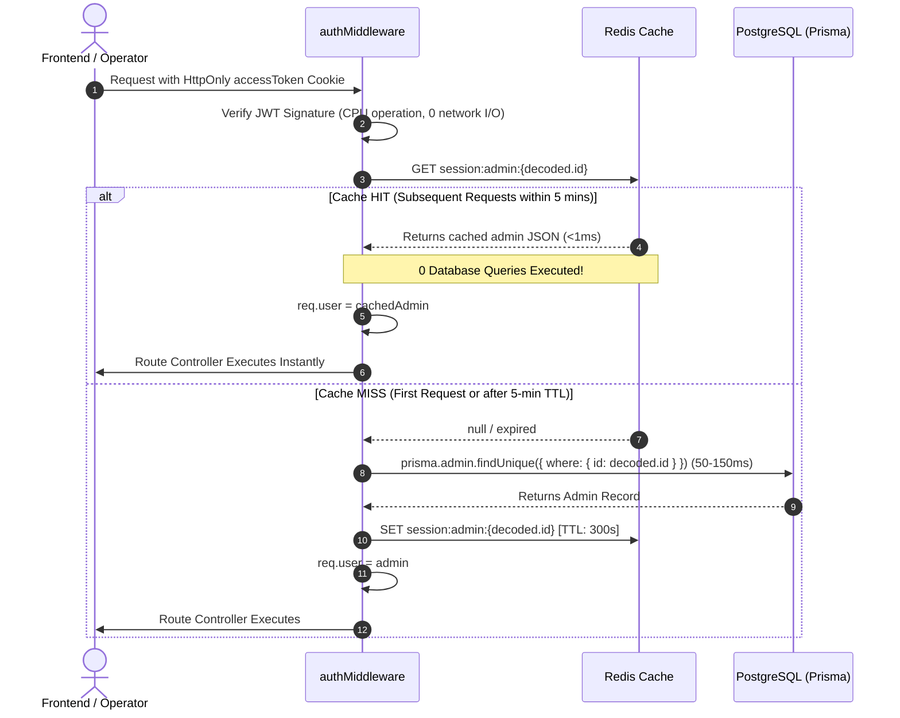

## 5. Redis Session Caching Architecture (Database Hit Optimization)

### The Problem (PostgreSQL Bottleneck at Scale)

In a high-throughput milk collection center, procurement shifts occur in compressed 2-hour windows (6:00 AM – 8:30 AM and 5:00 PM – 7:30 PM). 
- Operators record **500+ milk deliveries per minute** using rapid-entry forms.
- **Previous Implementation:** Every single HTTP request (`POST /milk/milk-entry`, `GET /customer/all-customers`, `GET /dashboard`, etc.) triggered `authMiddleware`, which executed:
  ```typescript
  const admin = await prisma.admin.findUnique({ where: { id: decoded.id } });
  ```
- **Consequences:**
  1. **Connection Pool Starvation:** Supabase / PostgreSQL connection pool quickly exhausted under concurrent requests.
  2. **High Latency Overhead:** Every request paid a 50ms–150ms network round-trip time (RTT) penalty to the hosted database just to re-verify an admin profile that rarely changes.
  3. **Unnecessary Compute Costs:** Wasted database CPU and I/O cycles serving static configuration reads (`dairyName`, `collectionType`, `paymentPeriod`).

---

### The Solution: Cache-Aside Session Architecture

We implemented a **Redis-backed Cache-Aside (Lazy Loading)** session verification pattern with a 5-minute (300-second) TTL and automated write-invalidation:



---

### Why We Chose Redis Over Alternative Architectures

| Architecture Option | Latency | Distributed Scalability | Consistency & Invalidation | Token Size | Verdict |
|---|:---:|:---:|:---:|:---:|---|
| **Option 1: PostgreSQL Hit on Every Request (Previous)** | 50ms – 150ms | Poor (DB connection pool limits throughput) | Immediate | Small | ❌ **Rejected:** Bottlenecks DB during rush morning milk collection shifts. |
| **Option 2: Stateless JWT Profile Embedding** | <1ms | Excellent | Broken (Settings changes require re-login; cannot revoke immediately) | Large (Cookie bloat on every request) | ❌ **Rejected:** Stale business settings, security revocation issues. |
| **Option 3: In-Memory Node.js Map / Process Memory** | <0.1ms | Broken (Fails when scaling across multi-instance PM2/Docker clusters) | High drift between process instances | Small | ❌ **Rejected:** Cluster nodes have out-of-sync session states. |
| **Option 4: Redis Cache-Aside + Automated Invalidation (CHOSEN)** | **<1ms** | **Flawless (Shared by all server instances/containers)** | **Strict Consistency (Instant cache purge on updates)** | **Compact (Standard ID in JWT)** | ✅ **Selected: Enterprise Standard** |

#### Key Technical Advantages of the Redis Choice:
1. **Sub-Millisecond In-Memory Reads:** Redis operates entirely in RAM, reducing session authentication overhead from ~100ms down to **< 1ms**.
2. **Horizontal Scalability:** When LactoFlow scales across multiple Node.js worker processes or container instances (Docker/Kubernetes), all backend nodes query the **same centralized Redis cache**, preventing session drift.
3. **Automated Key Expiration (TTL):** The 300-second TTL prevents memory bloat by naturally evicting inactive sessions.
4. **Resilient In-Memory Fallback:** The `CacheService` includes an automatic in-memory TTL Map fallback, guaranteeing the server functions seamlessly during local development if Redis is not installed.

---

### Cache Invalidation Lifecycle (Zero Stale State)

To guarantee that operators never see stale configuration or profile data, the session cache is automatically purged during state-changing mutations:

```
[ Admin updates settings or profile ]
               |
               v
      Admin Service Mutation
               |
               +---> 1. Persist Update to PostgreSQL (prisma.admin.update)
               |
               +---> 2. Invalidate Redis: cache.del("session:admin:<adminId>")
                           |
                           v
               [ Next request automatically fetches fresh data from DB and re-caches ]
```

| Action / Route | Target Cache Operation | Result |
|---|---|---|
| `PATCH /api/v1/admin/profile` | `cache.del("session:admin:<id>")` | Fresh owner & contact details re-cached on next call |
| `PATCH /api/v1/admin/dairy-info` | `cache.del("session:admin:<id>")` | Fresh dairy name, village, and GSTIN reflected immediately |
| `PATCH /api/v1/admin/settings` | `cache.del("session:admin:<id>")` | Fresh milk type, shift, and payment cycle defaults applied instantly |
| `POST /api/v1/admin/change-password` | `cache.del("session:admin:<id>")` | Cached session evicted |
| `POST /api/v1/auth/logout` | `cache.del("session:admin:<id>")` + delete refresh token | Full session termination across cache and cookies |


```

HTTP Request: POST /api/v1/milk/milk-entry
      │
      ▼
┌────────────────────────────────────────────────────────────────────────┐
│  Phase 1: In authMiddleware                                            │
│                                                                        │
│  1. Check JWT Cryptographic Signature (jwt.verify)                     │
│     - Was the token signed by our server secret?                       │
│     - Has the token expired?                                           │
│                                                                        │
│  2. Query 1 to PostgreSQL: (THE BOTTLENECK)                            │
│     SELECT * FROM admins WHERE id = '...'                              │
│     - Does this dairy owner still exist in the database?               │
│     - Pull all profile fields: dairyName, village, collectionType,     │
│       milkType, paymentPeriod, etc.                                    │
│     - Attach req.user = admin                                          │
└──────────────────────────────────┬─────────────────────────────────────┘
                                   │
                                   ▼
┌────────────────────────────────────────────────────────────────────────┐
│  Phase 2: In milkEntry.service.ts                                      │
│                                                                        │
│  3. Query 2 to PostgreSQL: (Customer Ownership Check)                  │
│     SELECT * FROM customers WHERE adminId = '...' AND code = 101       │
│     - Does Farmer #101 exist?                                          │
│     - Does Farmer #101 belong to THIS dairy owner?                     │
│                                                                        │
│  4. Query 3 to PostgreSQL: (Duplicate Shift Check)                     │
│     SELECT * FROM milk_entries WHERE customerId = '...'                │
│       AND shift = 'MORNING' AND date = TODAY                           │
│     - Did this farmer already deliver milk this morning?               │
│                                                                        │
│  5. Query 4 to PostgreSQL: (Write / Insert)                            │
│     INSERT INTO milk_entries (quantity, fat, snf, rate, totalAmount)   │
│     - Save the actual milk transaction record to PostgreSQL.           │
│                                                                        │
│  6. Non-blocking Redis Cache Update                                    │
│     - Prepend new entry to today-milk-entries in Redis.                │
└────────────────────────────────────────────────────────────────────────┘


```

What was the specific problem with Phase 1?

Notice the difference between the queries:

Queries 2, 3, and 4 are essential business logic:

You must check if Farmer #101 belongs to this dairy.
You must check if Farmer #101 already poured milk this shift.
You must save the milk entry to the database.

Query 1 (in authMiddleware) was completely redundant:

The JWT already cryptographically proved that the dairy owner was authenticated.
Yet, for all 500 milk entries during the morning rush, authMiddleware was asking PostgreSQL the exact same question 500 times:

"Hey PostgreSQL, does this same dairy owner still exist? Pull their dairy name, district, state, and payment preferences again."

This added a 50ms–150ms network delay to every single milk entry just to fetch static admin information that hadn't changed.


| Operation | Previously (Without Redis Session) | Now (With Redis 5-min Session) |
| --- | --- | --- |
| Query 1: Dairy Authentication | Hit PostgreSQL every time (50–150ms) | Checked in Redis RAM (< 0.5ms) |
| Query 2: Farmer Check | Hit PostgreSQL | Hit PostgreSQL (essential) |
| Query 3: Duplicate Shift Check | Hit PostgreSQL | Hit PostgreSQL (essential) |
| Query 4: Insert Milk Entry | Hit PostgreSQL | Hit PostgreSQL (essential) |
| Total DB Queries per 500 entries | 2,000 DB queries (500 were just checking the admin) | 1,501 DB queries (Admin checked only once in 5 mins) |


### Result: PostgreSQL is freed from handling 500 repetitive admin lookups and can dedicate 100% of its connection pool and IOPS to rapidly saving the actual milk delivery data